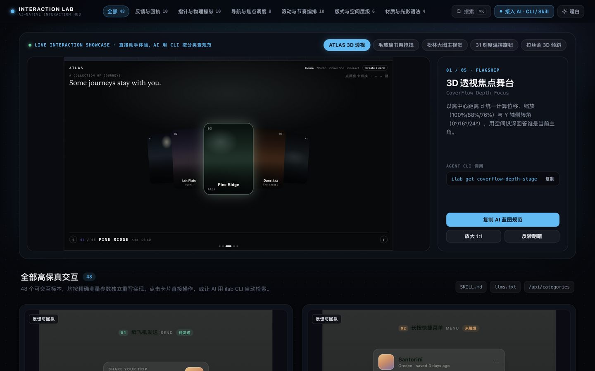

# Interaction Lab

**AI-Native 交互标本馆：48 个可上手把玩的 UI/UX 交互标本 + 零依赖 `ilab` CLI + Agent `SKILL.md`。**

[](https://github.com/fatherplus/interaction-lab/actions/workflows/ci.yml)
[](https://ilab.hongme.xyz)
[](LICENSE)
[](https://www.python.org/)



Interaction Lab 把 48 个高保真交互实现按 **6 大交互意图** 组织起来，同时服务两类使用者：

1. **人类**：一个不做多余装饰的桌面画廊。每个标本都能直接操作——拖、按、滚动、悬停——并支持 1:1 放大与暗室/暖白双主题。
2. **AI Agent**：一条 `ilab` 命令即可取回精确的 CSS Token 契约、显式状态机、反模式禁区（DO NOT）和可运行代码骨架，让轻量模型也能产出有质感的交互，而不是 `transition: all .5s ease`。

全部 48 个标本均为**零外部依赖的单文件 HTML**，整站由一份 `data/patterns.json` 驱动生成。

---

## 目录

- [特性](#特性)
- [快速开始](#快速开始零第三方依赖)
- [给 AI Agent 接入](#给-ai-agent-接入10-秒)
- [HTTP API](#http-api)
- [遥测与隐私](#遥测与隐私)
- [部署](#部署)
- [项目结构](#项目结构)
- [新增一个标本](#新增一个标本)
- [出处与致谢](#出处与致谢)
- [参与贡献](#参与贡献)
- [License](#license)

## 特性

- **48 个实时标本，6 大意图分类**：反馈与回执、直接操纵、导航与焦点、滚动节奏、空间层级、表面光学。
- **一份数据源**：`data/patterns.json` 是唯一真相，生成画廊、`/api/patterns.json`、`llms.txt`、48 份 `.md` 规范与 48 个独立标本页。
- **零第三方依赖**：仅需 Python 3.9+ 标准库。没有 npm、没有构建链、没有 CDN。
- **双轨埋点**：浏览器交互（`sendBeacon` 批量上报）与 Agent/CLI 查询分别入库，含「搜索无结果」缺口视图；可用 `IL_TELEMETRY=off` 整体关闭。
- **桌面优先**：按 Mac / 桌面浏览器验收；遵循 `prefers-reduced-motion`，完整键盘可达与 `focus-visible`。

## 快速开始（零第三方依赖）

需要 Python 3.9+，不需要 `pip install`。

```bash
git clone https://github.com/fatherplus/interaction-lab.git
cd interaction-lab

# 1. 构建：画廊、48 份标本、.md 规范、llms.txt、CLI 与 Skill
python3 build.py

# 2. 启动静态托管 + AI API + SQLite 埋点（默认 http://127.0.0.1:8900）
python3 server/app.py

# 3. 查看实时埋点统计
python3 server/stats_cli.py
```

`build.py` 结束时会执行公开前的安全检查：产物中若出现内网地址、个人绝对路径或密钥，构建直接失败。

## 给 AI Agent 接入（10 秒）

服务启动后（或部署到公网域名后），页面右上角 **「接入 AI · CLI / Skill」** 会给出可直接复制的命令。手工安装：

```bash
# 零依赖 CLI：下载时服务端自动注入当前站点地址
mkdir -p ~/.local/bin
curl -fsSL http://127.0.0.1:8900/cli/ilab -o ~/.local/bin/ilab
chmod +x ~/.local/bin/ilab

# Agent Skill（Claude Code / Cursor / Codex / Antigravity 通用）
mkdir -p ~/.agents/skills/interaction-lab
curl -fsSL http://127.0.0.1:8900/SKILL.md -o ~/.agents/skills/interaction-lab/SKILL.md
```

```bash
ilab categories                              # 6 大交互意图分类
ilab list navigation-focus                   # 按分类列出全部交互
ilab search "按钮没反馈"                      # 中英文症状词反查
ilab get coverflow-depth-stage               # Token + 状态机 + DO NOT + 代码骨架
ilab get coverflow-depth-stage --raw-html    # 完整高保真单文件源码
```

CLI 通过 `ILAB_URL` 指向任意已部署实例（下载得到的 `ilab` 已内置当前站点地址）。

## HTTP API

| 方法 | 路径 | 说明 |
| :--- | :--- | :--- |
| `GET` | `/` | 桌面画廊 |
| `GET` | `/specimens/{id}.html` | 独立单文件标本 |
| `GET` | `/patterns/{id}.md` | 单个标本的 Agent 规范（Markdown） |
| `GET` | `/api/categories` | 6 大分类及各自标本数 |
| `GET` | `/api/search?q=&category=&drive=&id=` | 症状词 / 分类 / 驱动方式检索 |
| `GET` | `/api/patterns.json` | 完整机器可读目录 |
| `GET` | `/llms.txt` | 面向 AI 的站点索引 |
| `GET` | `/SKILL.md` | Agent Skill 原文 |
| `GET` | `/api/health` | 聚合健康状态（不含个人数据） |
| `POST` | `/api/t` | 浏览器批量埋点（≤25 事件，≤32KB） |

## 遥测与隐私

- 服务端不存明文 IP：访客标识为 `HMAC-SHA256(salt, ip|ua)` 的前 24 位十六进制。
- 首次启动会在数据库旁生成 `.telemetry_salt`（或读取 `IL_TELEMETRY_SALT`）。**迁移/多实例部署时请固定同一个 salt**，否则访客哈希会漂移。
- 记录内容：事件类型、标本 ID、分类、来源域名、粗粒度 UA 家族、CF 国家码（若存在）、检索词（截断 64 字符）。不记录 Cookie、不记录完整 UA 以外的人群信息。
- `IL_TELEMETRY=off` 可关闭全部采集（仍会返回空 202，前端无感）。
- `/api/health` 只返回事件总数、会话数与数据库体积。

## 部署

Docker（推荐，镜像内已 `HEALTHCHECK`）：

```bash
docker compose up -d --build
# 容器仅监听 127.0.0.1:8900，前面挂 Caddy/Nginx 终止 TLS
```

完整步骤（子域名 + 自动 HTTPS + 备份 + 回滚）见 **[docs/DEPLOY.md](docs/DEPLOY.md)**，含 `deploy/` 下的 Caddyfile、Nginx 配置、systemd 单元与发布脚本。

| 环境变量 | 默认值 | 说明 |
| :--- | :--- | :--- |
| `IL_HOST` | `127.0.0.1` | 监听地址（容器内为 `0.0.0.0`） |
| `IL_PORT` | `8900` | 监听端口 |
| `IL_DB_PATH` | `data/telemetry.sqlite` | SQLite 路径（容器内 `/data/telemetry.sqlite`） |
| `IL_TELEMETRY` | `on` | `off` 关闭全部采集 |
| `IL_TELEMETRY_SALT` | 自动生成 | 固定访客哈希盐 |
| `IL_QUIET` | 未设置 | `1` 关闭访问日志 |

## 项目结构

```
data/patterns.json        # 唯一数据源：6 分类 × 48 标本
src/index.html            # 画廊外壳
src/css/ src/js/          # 画廊样式、AI 引擎、埋点 SDK、控制器
src/pages/ep*.html        # 6 个交互世界（标本来源）
src/pages/anim-lab/       # 16 个动效标本来源
src/chrome.css            # 各标本页共享顶栏
scripts/extract_specimens.py  # 从来源页抽取 48 个独立标本
build.py                  # 构建 + 公开前安全门禁
server/app.py             # 静态托管 + API + 埋点接收
server/db.py              # SQLite (WAL) schema 与写入
server/stats_cli.py       # 终端统计
cli/ilab                  # 零依赖 CLI（构建时注入站点地址）
skill/SKILL.md            # Agent Skill
docs/                     # 设计系统、架构、部署、出处
deploy/                   # Caddy / Nginx / systemd / 发布脚本
tests/                    # 标准库 unittest 冒烟测试
```

`dist/` 是构建产物，不入库。

## 新增一个标本

1. 在 `src/pages/` 的某个世界里实现交互（单文件、无外部依赖）。
2. 在 `data/patterns.json` 的 `patterns[]` 中新增条目：`id`、分类、`tokens`、`state_machine`、`do_not`、`self_check`、`code_snippet` 等（字段见 [data/schema.md](data/schema.md)）。
3. 在 `scripts/extract_specimens.py` 的 `SPECIMEN_MAP` 中登记抽取源。
4. `python3 build.py && python3 -m unittest discover -s tests`。

## 出处与致谢

48 个标本的交互思想与关键参数，来自公开的交互设计教学视频：**抖音 @叨叨AI（EP26–31，6 个界面方向）** 与 **@大锤师傅（16 个动效）**。本项目逐帧测量参数后用原生 HTML/CSS/JS **独立重写**了全部代码，未复制任何原始素材、视频或图片；页面中的实现、文案与工程结构均为本项目原创。

如果你认为某处标注不准确，或希望调整署名方式，请开 issue，我们会及时处理。

展示字体：`assets/` 内附 **Bricolage Grotesque**（SIL Open Font License 1.1，见 `assets/OFL.txt`）。当前界面使用系统字体栈，这些资产保留给需要自托管展示字体的自建版本，默认构建不引用它们。

## 参与贡献

欢迎补标本、修参数、改文案。动手前请读 [CONTRIBUTING.md](CONTRIBUTING.md)：三条硬约束是零第三方依赖、数据同源（`data/patterns.json`）和桌面优先。开发循环就是 `python3 build.py && python3 -m unittest discover -s tests -v`。

## License

[MIT](LICENSE) © 2026 Honggangfeng
